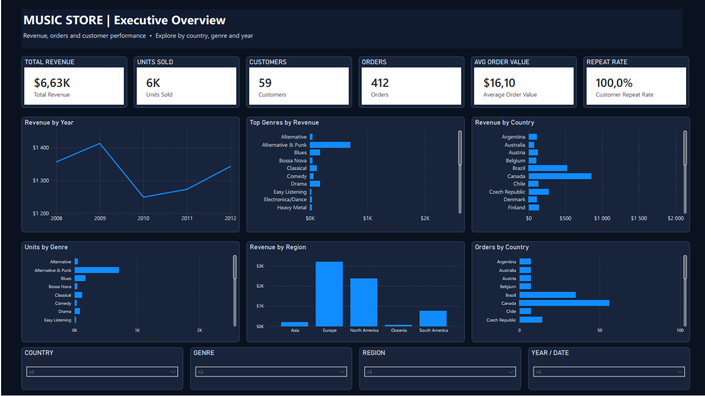
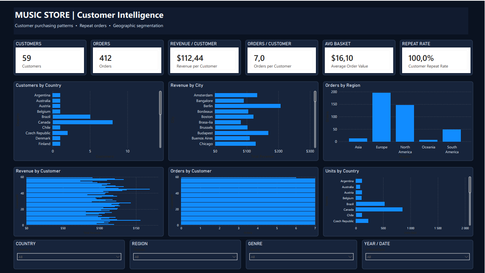
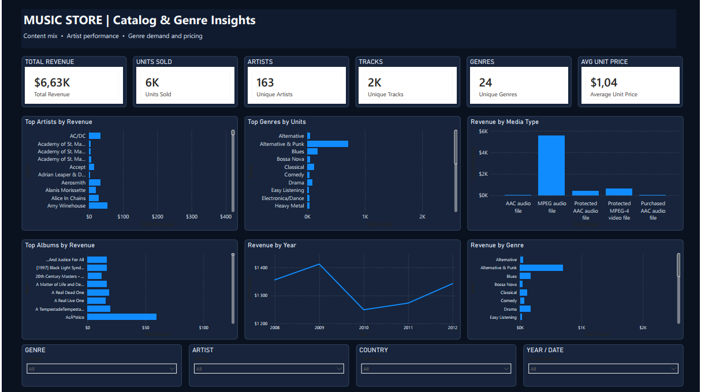

# Music Store | Commercial Intelligence Dashboard

### Power BI · Sales Analytics · Customer Intelligence · Product & Genre Performance

An interactive, three-page **Power BI business intelligence portfolio project** exploring the commercial performance of a digital music store. The report brings together sales, customer, geographic, and music catalog information to help answer practical business questions: **Where does revenue come from? Who buys? Which products and genres perform best?**

> **Project type:** Educational / portfolio analytics project  
> **Tool:** Microsoft Power BI Desktop  
> **Report pages:** 3  
> **Data:** Music store transactional and catalog dataset supplied for educational analysis  
> **Author:** Anton Shuleshov

---

## Dashboard at a glance

| Executive Overview | Customer Intelligence | Catalog & Genre Insights |
|:---:|:---:|:---:|
|  |  |  |

**Download the interactive report:** [`1.pbix`](1.pbix)  
**View the static report:** [`1.pdf`](1.pdf)

> Screenshots and figures reflect the report's current dataset and default filter context. Interactive selections can change the displayed values.

## 1. Business context and objectives

A music retailer needs more than a total-sales figure to understand its business. Revenue may vary across countries, customers, music genres, and media formats. A useful reporting solution should make those differences visible and allow users to investigate them without rebuilding charts.

This project was designed to:

- Monitor overall revenue, sales volume, orders, and customer activity.
- Compare geographic demand across countries, cities, and regions.
- Explore customer purchasing behavior and order frequency.
- Identify higher-performing artists, albums, genres, and media types.
- Examine historical revenue trends.
- Enable interactive filtering by geography, music category, and time.

## End-to-end analytics workflow

This repository demonstrates more than dashboard construction. It documents a practical BI workflow from transactional data to interactive decision-support reporting.

| Stage | Applied work | Skills demonstrated |
| --- | --- | --- |
| Business questions | Define performance, customer and catalog questions | Requirements framing, KPI design |
| Source ingestion | Import the educational `Music Sales` Excel dataset | Data acquisition, source profiling |
| Data preparation | Prepare fields and types in Power Query and the semantic model | Data preparation, transformation |
| Metric validation | Correct the source model's revenue logic to `Quantity × UnitPrice` | Data-quality controls, business-rule validation |
| Semantic modeling | Create and maintain DAX measures for revenue, customers, orders and purchasing behavior | DAX, aggregation, filter context |
| Exploratory analysis | Compare time periods, geographies, customer segments, artists and genres | EDA, segmentation, trend analysis |
| Interactive reporting | Design three report pages with cross-filtering slicers | Power BI, information design, storytelling |

**Data-quality example:** the training model initially multiplied revenue by `CustomerID`. That identifier is not a price or quantity; the corrected revenue calculation uses `Quantity × UnitPrice`. This illustrates why validating business definitions is essential before presenting KPIs.

**Technology scope:** Power BI, Power Query (M), DAX and Excel are directly relevant to this repository. SQL, R, Pig and Hive are part of the wider learning portfolio but are not claimed as implemented in this music-store report.

## 2. Report pages

### Page 1 — Executive Overview


**Purpose:** A high-level view of store performance and the distribution of sales.

**KPIs shown in the report**

| Metric | Displayed value |
|---|---:|
| Total Revenue | $6.63K |
| Units Sold | 6K |
| Customers | 59 |
| Orders | 412 |
| Average Order Value | $16.10 |
| Customer Repeat Rate | 100.0% |

**Visual analysis:** Revenue by year; top genres by revenue; revenue by country; units by genre; revenue by region; and orders by country.

**Questions addressed:** How is revenue changing over time? Which regions contribute the most? How do order volumes and music preferences differ geographically?

### Page 2 — Customer Intelligence


**Purpose:** Understand the customer base, geographic concentration, and purchase frequency.

**KPIs shown in the report**

| Metric | Displayed value |
|---|---:|
| Customers | 59 |
| Orders | 412 |
| Revenue per Customer | $112.44 |
| Orders per Customer | 7.0 |
| Average Basket / Order Value | $16.10 |
| Customer Repeat Rate | 100.0% |

**Visual analysis:** Customers by country; revenue by city; orders by region; revenue by customer; orders by customer; and units by country.

**Questions addressed:** Where are customers located? How concentrated is revenue among customers? How frequently do customers purchase? Which locations generate higher demand?

### Page 3 — Catalog & Genre Insights


**Purpose:** Explore the contribution of music products, genres, artists, albums, and media formats to commercial results.

**KPIs shown in the report**

| Metric | Displayed value |
|---|---:|
| Total Revenue | $6.63K |
| Units Sold | 6K |
| Unique Artists | 163 |
| Unique Tracks | 2K |
| Unique Genres | 24 |
| Average Unit Price | $1.04 |

**Visual analysis:** Top artists by revenue; top genres by units; revenue by media type; top albums by revenue; revenue by year; and revenue by genre.

**Questions addressed:** Which genres drive volume versus revenue? Which artists and albums perform best? What role do different media types play in sales?

## 3. Interactive analysis

The report includes page-level slicers for exploring different segments. Depending on the page, these cover:

- **Country** and **Region** — geographic comparisons.
- **Genre** and **Artist** — catalog segmentation.
- **Year / Date** — time-based exploration.

Users can also interact with supported charts to explore the data in context. The `.pbix` file is required for the interactive experience; the PDF and PNG files are static previews.

## 4. Data and analytical model

The analysis uses a music store dataset combining transaction-level sales information with customer and catalog attributes. Fields visible in the model include customer identifiers and locations, invoice dates and identifiers, orders, tracks, artists, albums, genres, media types, quantities, and monetary values.

The report organizes the information into three analytical perspectives:

| Perspective | Examples of dimensions | Examples of measures |
|---|---|---|
| Commercial performance | Year, country, region | Revenue, orders, units, average order value |
| Customer behavior | Customer, city, country | Customers, revenue per customer, orders per customer, repeat rate |
| Catalog performance | Artist, album, genre, media type | Revenue, units, distinct artists/tracks/genres, average unit price |

**Power BI techniques demonstrated:** Data modeling, calculated measures and KPIs, time-based comparisons, geographic segmentation, categorical ranking, cross-filtered visualizations, and multi-page report design.

> **Interpretation note:** The dashboard displays a 100% customer repeat rate in its current context. That figure should be interpreted according to the repeat-customer definition used in the model and the coverage of the educational dataset; it is not a general benchmark for music retail.

## 5. Selected observations

The report offers several starting points for deeper analysis:

- The customer overview displays **59 customers** and **412 orders**, equivalent to approximately **7 orders per customer** in the displayed context.
- Revenue is distributed unevenly across geographic markets, making country- and region-level comparisons useful.
- Genres and media types show different contributions to revenue and unit volume, supporting a distinction between **demand** and **monetary performance**.
- The catalog page provides a way to investigate the relative performance of artists and albums rather than relying only on store-wide totals.

These are **descriptive observations**, not causal conclusions. They should be validated against the active slicers and underlying measure definitions before being used for decisions.

## 6. Repository contents

```text
music-store-commercial-intelligence/
├── 1.pbix                 # Power BI Desktop interactive report
├── 1.pbip                 # Power BI Project entry point
├── 1.Report/              # Power BI report definition
├── 1.SemanticModel/       # Power BI semantic model definition
├── Data/                  # Educational source data
├── 1.pdf                  # Three-page static PDF export
├── 1.png                  # Executive Overview screenshot
├── 2.png                  # Customer Intelligence screenshot
├── 3.png                  # Catalog & Genre Insights screenshot
└── README.md              # Project documentation
```

## 7. How to open the project

**Recommended — Power BI Desktop:**

1. Download [`1.pbix`](1.pbix) from this repository.
2. Open it in **Microsoft Power BI Desktop** on Windows.
3. Explore the three report pages and use the slicers to filter the data.
4. If refreshing the data, update the source file path in **Transform data → Data source settings** to point to the files in the downloaded `Data/` folder.

**Project source:** The repository also includes [`1.pbip`](1.pbip) and its associated `1.Report/` and `1.SemanticModel/` folders. Download the repository as a ZIP and preserve the folder structure before opening the PBIP entry file.

**Without Power BI:** Open [`1.pdf`](1.pdf) or view the three screenshots above. These are read-only previews.

## 8. Skills demonstrated

`Power BI` · `Business Intelligence` · `Data Visualization` · `Sales Analytics` · `Customer Segmentation` · `Revenue Analysis` · `Geographic Analysis` · `Product Performance` · `KPI Design` · `Data Modeling` · `Interactive Dashboards`

## 9. Scope and limitations

- This is an **educational portfolio project**, not a production reporting system.
- Results describe the supplied dataset; they should not be generalized to the wider music industry.
- Displayed figures are rounded and may differ slightly from calculations using unrounded values.
- Some report visuals use scrolling to display additional categories.
- Refreshing from a different computer may require updating local data-source paths.
- Screenshots and the PDF are static; interactive behavior is available in Power BI Desktop.

---

### About the author

**Anton Shuleshov**  
Data Analytics & Business Intelligence Portfolio  
[GitHub profile](https://github.com/anton-shuleshov)

*This project demonstrates the translation of transactional data into accessible commercial insights through a structured, interactive Power BI report.*


